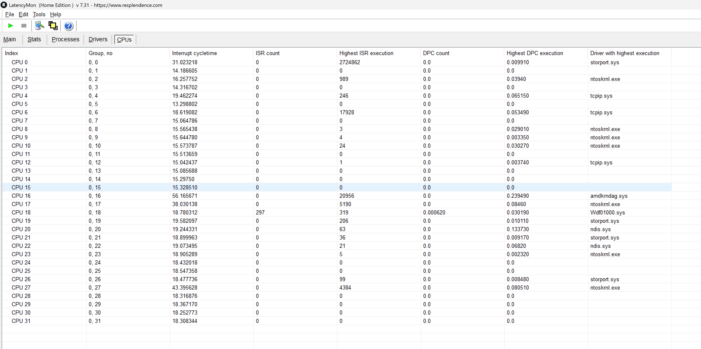
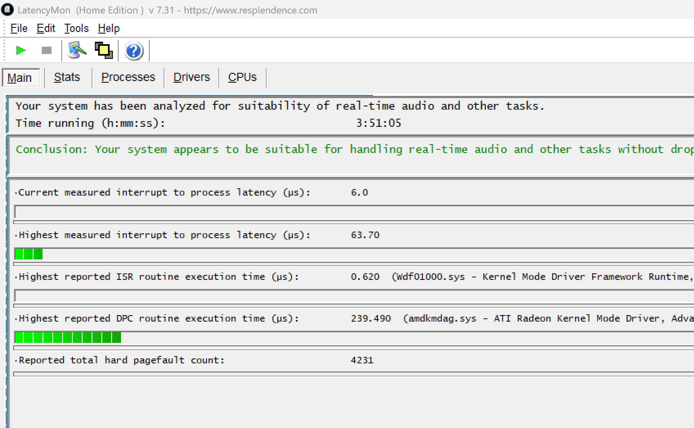

# Stutter Guard

[](LICENSE)
[-purple.svg)](https://dotnet.microsoft.com/)
[-0078d4.svg)](https://microsoft.com/windows)
[](https://github.com/Kareem-Shabaka/stutter-guard/releases)
[](tests/DpcTweaker.SelfTest)

## Average FPS is not the number that decides whether a game feels smooth.

It measures compute. It does not measure what happens when your mouse moves, a packet arrives, or a
sound plays mid-fight, because none of that is compute. It is interrupt work, and Windows delivers it
to whichever core it likes - including the one your game is on. That is where a good average and a bad
frame time come from the same machine.

**Stutter Guard moves every busy device's interrupts onto a core of its own, chosen by measured wake
latency, away from the cores your game uses. Then it records every change it made, so you can put all
of it back.**

### [Download Stutter Guard 1.4.1](https://github.com/Kareem-Shabaka/stutter-guard/releases/latest)

One self-contained `.exe`, about 65 MB, Windows 10 or 11 x64. No installer, no .NET runtime, no account.



---

## The difference, in one table

| | Measures | Changes | Proves it helped | Reversible |
| :--- | :---: | :---: | :---: | :---: |
| LatencyMon | **yes** | no | - | - |
| Process Lasso / IRQControl | no | **yes** | no | partially |
| "Optimiser" suites | no | **yes** | no | rarely |
| **Stutter Guard** | **yes** | **yes** | **yes, per row** | **completely** |

Most tools do one half of the job. Monitors tell you something is wrong and change nothing. Tweakers
change things and cannot tell you whether it worked. Stutter Guard measures per core, moves devices
accordingly, states the evidence behind each change, and hands you a script that undoes all of it.

---

## Everything it does for you

| Benefit | What makes it true |
| :--- | :--- |
| **Your game's cores stop being shared with hardware** | Device interrupts are pinned to cores the plan reserves for them. On AMD dual-CCD V-Cache parts the entire V-Cache CCD is kept free of devices; on Intel hybrid, P-cores stay for the game. |
| **You get a measured number, not a mood** | Each core is ranked by a short wake-jitter and speed benchmark, plus Windows' own scheduling hints - not by folklore about which cores are "better". |
| **Every change can be undone, from Safe Mode, without this app** | Each write is journalled to disk *before* it happens, and `undo-all.ps1` is regenerated on every flush. No app, no installer, no network. |
| **A Windows update cannot silently keep your tweaks reverted** | Driver fingerprinting notices when an applied tweak was reset, names it on the Home screen, and re-applies it in one click - from the recorded factory value. |
| **You see why something is greyed out** | Every tweak carries `Evidence` (Measured / Documented / Anecdotal) and a `Cost`. Anecdotal tweaks appear only in the `Everything` tier. Unclassified ones are not selectable at all. |
| **Nothing is installed behind your back** | One `.exe`. No installer, no service, no tray icon, no updater, no bundled cleaner. The only thing it can leave running is a scheduled task you tick yourself, and it is journalled like everything else. |
| **Known-bad drivers are identified, not guessed at** | Installed driver versions are matched against a catalogued set of regressions using the same identifiers Windows itself matches on: hardware ids, compatible ids, and instance id. |
| **Network work lands where its interrupts do** | The adapter's receive-queue keywords are derived from the same processor span as its interrupt mask, so a receive queue's DPC lands on the core that services its ISR. |
| **Five areas, one contract** | Interrupts, power plan, network link, GPU driver keys, and background tasks. Every row across all five states what it does, why it works, what it costs, and what can break. |

---

## The numbers, with their conditions

Every figure on this page names its instrument. No exception, because a number without one is a
number you have to take on faith - which is what "snake oil" means.

**The mechanism, measured.** A ready thread waiting on a processor reserved for interrupts waits a
median of **782 µs** while synthetic load holds those cores busy. The same thread on a processor with
no device pinned to it waits **8.9 µs**. A control processor, never loaded, stayed at 10.7 µs - which
is what makes this a locality result and not just a busy machine.

> 2,400 wake-ups per cell, two rounds, arm order rotated, load held at seven threads in both arms,
> placement verified by per-processor utilisation. Ryzen 9 9950X3D. [Full method and limits.](docs/MEASUREMENT.md)

**The plan, verified on real hardware.** Over 3 h 51 min of desktop idle with the three displays at
240 / 120 / 60 Hz: every one of the **297 interrupts** recorded was serviced on **CPU 18**, the core
the plan gives the USB input controller. The V-Cache CCD took **zero**. Fourteen of 32 processors took
no interrupt and no DPC at all. **No DPC reached 250 µs** out of 2,775,336.



*The result that plan produces. That is the target rather than the problem: the case this app is for is
the one where a ready thread on a busy core waits 782 µs instead of 8.9 µs - a factor of about 90,
measured, with the method below.*

**Microsoft's budgets, for scale.** The documented ceiling is **100 µs** for one DPC routine and
**25 µs** for one ISR. The healthy run above peaked at 239.49 µs - 2.4 times budget, once, in nearly
four hours. That is the shape of a single long call, not a storm, and the app reports it as such.

---

## Which measurements move, and which cannot

The question that comes up most is a throughput benchmark before and after - Cinebench, 3DMark, a
Y-cruncher run. Those will show **no change**, and knowing why is the point of this section.

A throughput benchmark saturates a workload and asks how much work completed. Interrupt placement does
not change how many cores you have, what they clock to, or how many instructions they retire per second.
It changes **which processor performs device work**, and therefore **how long a ready thread waits** before
it gets one. That is a tail, not a rate.

| Instrument | Measures | Does this app move it? |
| :--- | :--- | :--- |
| Cinebench / 3DMark / Y-cruncher | Work completed under saturated load | **No.** Same cores, same clocks, same throughput |
| LatencyMon "highest interrupt to process" | One outlier across a whole run | Only if the outlier was itself a placement problem |
| **Core wake latency** (`tools/WakeProbe.cs`) | How late a ready thread runs | **Yes - 782 µs to 8.9 µs median**, measured, control core proving locality |
| **1 % / 0.1 % frame times** | The worst frames in a play session | **Yes**, when the stutter was device work landing on a render thread |
| Average FPS | Throughput while frames are steady | Only if it was already losing frames to stalls |

The measured result above is a **wake latency** figure, stated with its load condition, because that is the
quantity placement changes. A throughput number would be the wrong instrument for this claim - not a
weaker one.

**Can it cost throughput?** Only by misconfiguration, and the app refuses or states both cases: a
background mask that would leave fewer than four processors is not written at all, and the power tiers
print what they cost (a C1 cap trades some idle headroom for a flatter wake-up). On the `Safe` tier,
nothing here raises a clock, lowers a power limit or removes a core from the scheduler.

---

## Install in three steps

**1. Download and verify.** Get `StutterGuard.exe` and `StutterGuard.exe.sha256` from the
[releases page](https://github.com/Kareem-Shabaka/stutter-guard/releases/latest), then check the hash:

```powershell
Get-FileHash .\StutterGuard.exe -Algorithm SHA256
```

**2. Run it.** Windows asks for administrator rights, because interrupt and power settings are machine
scope. Single self-contained file, about 65 MB - there is no .NET runtime to install.

**3. Press a button that says what it does.** It scans first and changes nothing until you do. Every
action states what it is about to change, and states both counts before a tier switch.

Windows 10 or 11, x64.

---

## Why interrupt placement is the lever

Windows routes a device's interrupt using two documented mechanisms: the device's *Affinity Policy* and
its *MSI* properties, both read when the device starts. One affinity mask applies to all of a device's
interrupts; per-message targeting is reachable only from the driver.

Stutter Guard separates the two placements that decide your frame time:

1. **A pool of cores is protected** and never receives a device: CPU 0 and its SMT sibling, plus, on
   AMD dual-CCD 3D V-Cache parts, the whole V-Cache CCD.
2. **Each busy device gets a core** - GPU first, then the controller your mouse is on, then your audio
   path, then the network adapter, then remaining USB controllers. One core per device, first thread
   only, so an SMT sibling never halves a device's core.

### Why not just move the processes?

Because the scheduler has no interrupt-load heuristic. A process's affinity is a request, and a full
mask restricts nothing. Placement of the **devices** is what holds.

### Already tuned it by hand?

Choose `Keep pins that follow the rules`. A device already sitting on an allowed core stays exactly
where it is; only the rest are placed.

---

## Two architecture paths, stated rather than implied

| Path | Choose it when | What the app does |
| :--- | :--- | :--- |
| **Manual affinity** (Process Lasso, or this app alone) | You want device placement enforced | Parking off, tuned power plan, devices on their own cores |
| **Windows-managed placement** | You would rather Windows and the driver decided | Balanced plan, device power settings only |

The app never mixes them silently. The Power screen states which one you are choosing and what it
commits you to.

---

## Supported hardware

| Family | Examples | Placement |
| :--- | :--- | :--- |
| AMD dual-CCD 3D V-Cache | 9950X3D, 9900X3D, 7950X3D, 7900X3D | Whole V-Cache CCD interrupt-free; devices on the second CCD |
| AMD multi-CCD | 5950X, 5900X, 3900X | Devices on the secondary CCD |
| Intel hybrid | 12th-15th Gen, Arrow Lake | P-cores for game threads; E-cores for network and audio |
| Intel classic | i7-7700K, i5-4690K | CPU 0/1 reserved; remaining cores stay available |
| Single-CCD | 7600X, 5600X | Interrupt affinity applies; rule generation reports nothing to separate |

Not supported: Windows on ARM, more than 64 logical processors, and forcing MSI or custom affinity onto
NVMe drives or PCIe root bridges - which the app refuses by design, because a wrong value there can stop
the machine starting.

---

## FAQ

**Will it trip anti-cheat?**
No. It changes no kernel code, loads no driver, and patches no binary. Vanguard, Ricochet, Easy
Anti-Cheat, BattlEye and Xbox Game Pass inspect none of the registry values or device properties this
app writes.

**Can it damage my hardware?**
No setting here raises voltage, clocks or power limits. The real cost is that some power-saving states
are disabled, so idle power draw and temperature rise - and the rows that cause that say so.

**What if it breaks Windows?**
Boot into Safe Mode and run `%ProgramData%\Stutter Guard\undo-all.ps1`. It restores the recorded
originals with no app and no installer. It is regenerated on every change, so it is never out of date.

**Is the download signed?**
Only if the release page says so. Check with `Get-AuthenticodeSignature .\StutterGuard.exe`: `Valid` means
signed, `NotSigned` means it is not, and Windows SmartScreen will warn accordingly. Every release also
publishes a SHA-256 generated from the exact bytes uploaded - that verifies the file arrived intact, but it
does not prove who built it, because anyone able to replace the download could replace the checksum beside
it. `sign.cmd` signs a local build when a certificate is available; `signtool verify /pa` is the check.

**Do I need Process Lasso?**
Not for device placement - device interrupts are placed by this app. On the **TunedUltimate** path
Windows core parking is off, so Windows also stops moving game processes between CCDs; something has to
place them (Process Lasso, or your own CPU Sets rule), and this app does not do that. On the **Balanced**
path Windows keeps placing games and nothing else is required.

**Does it phone home?**
Never on its own. The hardware report and feedback are off until you press the button, and both show
you the exact payload - destination, full text, every attachment and its size - before sending anything.
No destination is built into the program: an address is configured once on your machine, and with none set
the buttons say so and the report is saved to a file instead.

**Windows 10?**
Yes, 10 and 11, x64.

---

## Scope

What it measures and changes, and where that stops:

- **Interrupt rates, not DPC durations.** Handler durations need kernel ETW, which a desktop app does
  not have on most systems. Rates and per-core totals are what this app reads; a single long DPC seen in
  LatencyMon is not something it can attribute or explain.
- **Device placement, not firmware.** System Management Interrupts are raised below the operating
  system. No register, mask or power setting reaches them, so SMIs are reported as a remaining cause
  and nothing beyond that is claimed.
- **Placement, not compositor work.** Each attached display is composited at its own cadence, so a
  mixed-refresh-rate setup costs GPU work that no interrupt mask changes. The app reports the cost.
- **One CPU and one GPU pair** (9950X3D, RX 9070 XT) stand behind the figures above. The mechanism is
  documented by Microsoft and applies generally; the 782 µs magnitude is specific to that hardware.

---

## For developers

```powershell
dotnet build -c Release
dotnet run --project tests/DpcTweaker.SelfTest -c Release   # 1,438 assertions
build.cmd                                                    # publish\StutterGuard.exe
build.cmd --verify-repro                                     # prove two clean builds match
```

```text
src/DpcTweaker.Core/   engine, journal, catalog, interrupt planner - no UI, so it tests headlessly
  Infra/               journal, backups, undo-script generation, registry, scheduled tasks
  Interrupts/          affinity planner, core benchmark, interrupt check, overlap detector
  Tweaks/              the catalog: every tweak declares evidence, cost, risk and revert path
  Detection/           topology, PnP nodes, displays, services, scheduled tasks
src/DpcTweaker.UI/     view models and page composition
src/DpcTweaker.App/    WPF shell, navigation, styles
tests/                 dependency-free self-test executable
tools/                 the instruments behind the published numbers
docs/                  measurement method, architecture, release notes
```

- [CONTRIBUTING.md](CONTRIBUTING.md) - build, test, and the `Evidence` / `TweakCost` contract.
- [SECURITY.md](SECURITY.md) - private disclosure, and exactly what this app can reach.
- [docs/ARCHITECTURE.md](docs/ARCHITECTURE.md) - the transaction shape and why it is built that way.
- [docs/MEASUREMENT.md](docs/MEASUREMENT.md) - every figure above, its method, and its limits.

---

## Releases

- [v1.4.1](docs/releases/RELEASE_NOTES_v1.4.1.md) - current
- [v1.4.0](docs/releases/RELEASE_NOTES_v1.4.0.md) - superseded (see 1.4.1)
- [v1.3.0](docs/releases/RELEASE_NOTES_v1.3.0.md)
- [v1.2.0](docs/releases/RELEASE_NOTES_v1.2.0.md)
- [v1.0.0](docs/releases/RELEASE_NOTES_v1.0.0.md)

---

## License and support

GPL-3.0. See [LICENSE](LICENSE) and [COPYRIGHT](COPYRIGHT). Commercial licensing on request.

If this saved you a weekend of LatencyMon logs, you can
[sponsor development](https://github.com/sponsors/Kareem-Shabaka). Sponsorship buys time to measure on
hardware other than one machine - the largest gap this project has.

## Acknowledgments

Microsoft's Windows Internals documentation and the Windows Driver Kit for the interrupt and power
contracts; the LatencyMon author for the instrument that made the investigation possible; Bitsum's
Process Lasso and IRQControl, whose own documentation clarified what `AssignmentSetOverride` can and
cannot do; and the maintainers of the driver regression reports this catalogue draws from.
