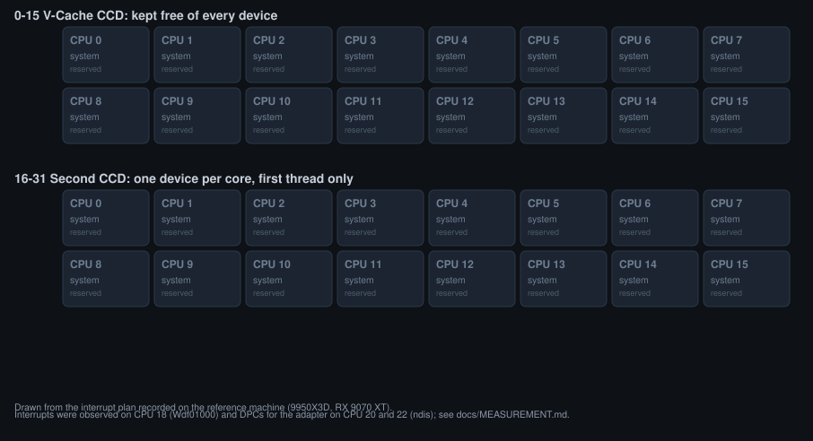

# Stutter Guard

[](LICENSE)
[-purple.svg)](https://dotnet.microsoft.com/)
[-0078d4.svg)](https://microsoft.com/windows)
[](https://github.com/Kareem-Shabaka/stutter-guard/releases)

**Windows micro-stutter often comes from driver work landing on the cores your game is running on.
Stutter Guard places each busy device's interrupts on a core chosen by measured wake latency, and
records every change it makes so you can put all of it back.**



*Drawn from the plan the app recorded on the reference machine. Interrupts were then observed on CPU 18
and the adapter's DPCs on CPU 20 and 22 - see [docs/MEASUREMENT.md](docs/MEASUREMENT.md).*

A render thread that gets preempted waits for the device routine that preempted it. When a network
adapter, a USB controller and a graphics card all deliver their interrupts to the same cores the game
is using, those waits are part of your frame time even though no benchmark measures them.

Measured on one machine (Ryzen 9 9950X3D, Radeon RX 9070 XT): a ready thread on a processor reserved
for interrupts waited a median of **782 µs**, against **8.9 µs** on a processor with no device pinned
to it, under held synthetic load, with a control core proving locality. Method and raw conditions:
[docs/MEASUREMENT.md](docs/MEASUREMENT.md).

## What it is not

It is not an optimiser. It installs no background updater, adds no tray icon, and bundles no registry
cleaner or disk tool. It does not touch kernel memory, patch binaries, or alter the services and
drivers used by anti-cheat systems. It changes documented registry values, a power plan, and device
interrupt settings, and it can name the previous value of each.

The one thing it can leave running is a scheduled task **you tick yourself**. Two optional tweaks
register a task (one at boot, one at logon) so a setting survives a restart without the app open. Each
is journalled like every other change, and Revert removes it.

## Why the changes are reversible

| Layer | What it does |
| :--- | :--- |
| **Write-ahead journal** | Every change writes its *previous* value to `%ProgramData%\Stutter Guard\journal.json` and flushes it to disk **before** the mutation runs. A power cut cannot leave a change without its record. |
| **Timestamped backups** | Original `.reg` exports, power-plan files and device CSV exports are copied to `Backups\<timestamp>\` before they are touched. |
| **`undo-all.ps1`** | Regenerated on every flush. Restores factory state with no app, no installer, and no dependency on this repository. Run it in Safe Mode. |
| **Drift healing** | If a driver or Windows update resets an applied tweak, the app notices on the next launch, names the tweak, and offers one Re-apply that still preserves the factory baseline. |
| **Per-row revert** | Any single tweak can be put back from its row, without touching the rest. |

## Evidence on every row

Each tweak declares two things, and the compiler enforces both:

- **Evidence:** `Measured`, `Documented` or `Anecdotal`.
- **Cost:** `Free`, `Cheap`, `Expensive` or `Unclassified`.

The presets are `Essential`, `Safe`, `Costly` and `Everything`. `Anecdotal` tweaks are never selected
below `Everything`, and an `Unclassified` tweak cannot be selected at all. A row also states what it
changes, why it should help, what it costs, and what could break.

## Install

1. Download `StutterGuard.exe` and `StutterGuard.exe.sha256` from the
   [releases page](https://github.com/Kareem-Shabaka/stutter-guard/releases).
2. Verify it:

   ```powershell
   Get-FileHash .\StutterGuard.exe -Algorithm SHA256
   ```

   Compare against the released hash. [SHA256SUMS.txt](SHA256SUMS.txt) explains why you verify against
   the published value rather than one you built yourself.

3. Run it. Windows asks for administrator rights, because registry and interrupt settings are machine
   scope. The app scans first and changes nothing until you press a button that says it will.

Single self-contained executable, no .NET runtime to install, about 65 MB. Windows 10 or 11, x64.

## What it can change

| Screen | Covers | Takes effect |
| :--- | :--- | :--- |
| **Interrupts** | Device interrupt affinity, MSI mode, network receive-queue (RSS) alignment | After a restart |
| **Power plan** | Power plan, C-states, EPP, processor minimum state, USB / PCIe / disk power saving | Immediately |
| **Network** | Energy-Efficient Ethernet, Green Ethernet, vendor link power saving, interrupt moderation | One adapter restart, 2-5 seconds |
| **GPU** | AMD driver registry keys, each filtered against the installed driver | Immediately |
| **Background** | Startup tasks, services and scheduled tasks, as three groups of opt-in rows | Immediately |

## Scope

What this app measures and changes, and where that stops:

- **Interrupt rates, not DPC durations.** Handler durations need kernel ETW, which a desktop app does not
  have on most systems. Rates and per-core totals are what this app reads; a single long DPC seen in
  LatencyMon is not something it can attribute or explain.
- **Device placement, not firmware.** System Management Interrupts are raised below the operating system.
  No register, mask or power setting reaches them, so SMIs are reported as a remaining cause and nothing
  is claimed beyond that.
- **Placement, not compositor work.** Each attached display is composited at its own cadence. A
  mixed-refresh-rate setup therefore costs GPU work that no interrupt mask changes; the app reports the
  cost.
- **One CPU and one GPU pair** (9950X3D, RX 9070 XT) stand behind the figures above. The mechanism is
  documented by Microsoft and applies generally; the 782 µs magnitude is specific to that hardware.

## How interrupt placement works

Windows lets a device's interrupt be routed to a chosen set of processors through two documented
mechanisms: a device's *Affinity Policy* and *MSI* properties in the registry, both read when the device
starts. `AssignmentSetOverride` carries **one** affinity mask that applies to **all** of a device's
interrupts; per-message targeting is reachable only from the driver.

Stutter Guard separates the two placements that matter:

1. **A small pool of cores is protected** and never receives a device: CPU 0 and its SMT sibling, plus,
   on AMD dual-CCD 3D V-Cache parts, the entire V-Cache CCD. On Intel hybrid CPUs, P-cores are kept for
   the game's threads.
2. **Each busy device gets a core**, ranked by a short benchmark of wake-up jitter and execution speed,
   and by Windows' own scheduling hints. One core per device, first thread only, so an SMT sibling never
   halves a device's core.

Network adapters get one more step: their receive-queue keywords are derived from the same span as their
interrupt mask, so a receive queue's DPC lands on the CPU that services its ISR.

This is what makes the measured difference: with nothing pinned, busy devices concentrate on a few
cores and a ready thread on one of them waits; with each device on its own core away from the game, it
does not.

### Why not just move the processes?

Because the scheduler has no interrupt-load heuristic. A process's affinity is a *request*, and a full
mask restricts nothing. Placement of the **devices** is the lever that holds.

### A note on manual affinity tools

If you already steer interrupts by hand, or with Process Lasso's Interrupt Affinity Policy, choose the
`Keep pins that follow the rules` placement mode. It keeps a device where an existing pin already
satisfies the app's rules and only places the rest.

## Driver latency advisories

The app compares installed driver versions against a catalogued set of known-bad releases, using the
identifiers Windows itself reports: a device's hardware ids, its compatible ids, and its instance id.
Vendor numbering differs between what a vendor publishes and what Windows records, so both forms are
compared - an AMD release name alongside its WDDM build, an NVIDIA `531.18` alongside `32.0.15.3118`.

Each verdict is one of **Update**, **Roll back**, or **Reconfigure / remove**, and the comparison only
happens between like-for-like version forms so that a four-part Windows string is never read as a
two-part vendor string.

## Optional diagnostics

The hardware report and feedback are **off unless you press the button**, and the app shows you the
exact payload - destination, full text, every attachment and its size - before anything is sent. Nothing
is transmitted on launch, on a timer, or in the background.

## Supported hardware

| Family | Examples | Behaviour |
| :--- | :--- | :--- |
| AMD dual-CCD 3D V-Cache | 9950X3D, 9900X3D, 7950X3D, 7900X3D | Whole V-Cache CCD kept interrupt-free; devices on the second CCD |
| AMD multi-CCD | 5900X, 5950X, 3900X | Devices on the secondary CCD |
| Intel hybrid | 12th-15th Gen, Arrow Lake | P-cores for game threads, E-cores for network and audio |
| Intel classic | i7-7700HQ, i7-6700K, i5-4690K | Reserved CPU 0/1 only; remaining cores stay available |
| Single-CCD | 5600X, 7600X | Interrupt affinity still applies; Process Lasso rule generation reports that there is nothing to separate |

Not supported: Windows on ARM, systems above 64 logical processors (processor groups beyond group 0),
and NVMe or PCIe root-bridge interrupt forcing, which the app refuses by design.

## FAQ

**Will it trip anti-cheat?**
It changes no kernel code, loads no driver, patches no binary, and touches nothing that Vanguard,
Ricochet, Easy Anti-Cheat or BattlEye inspect. It does set registry values and device interrupt
properties, which are ordinary machine configuration.

**Can these settings damage hardware?**
No setting here raises voltage, clocks or power limits. The one real cost is that some power-saving
states are disabled, so idle power draw and idle temperature rise. The app states that cost on the rows
that cause it.

**Does it work on Windows 10?**
Yes, 10 and 11, x64.

**What happens if it breaks Windows?**
Boot into Safe Mode and run `%ProgramData%\Stutter Guard\undo-all.ps1`. It restores the recorded
originals without the app. That script is regenerated on every change, so it is never out of date.

## Building from source

Needs the .NET 10 SDK.

```powershell
dotnet build -c Release
dotnet run --project tests/DpcTweaker.SelfTest -c Release   # 1,246 assertions
build.cmd                                                    # publish\StutterGuard.exe
build.cmd --verify-repro                                     # prove two clean builds match
```

`build.cmd` asks a running copy to close, publishes a single self-contained file, and logs to
`build-log.txt`. A clean build is byte-identical to another clean build of the same commit on the same
toolchain; `--verify-repro` demonstrates that on your machine before you publish anything.

## Project layout

```text
src/DpcTweaker.Core/   engine, journal, tweaks, interrupt planner, driver audit
  Infra/               journal, backups, undo-script generation, registry, tasks
  Interrupts/          affinity planner, core benchmark, interrupt check, overlap detector
  Tweaks/              the catalog: each tweak declares evidence, cost, risk and revert path
  Detection/           topology, PCI nodes, displays, services, scheduled tasks
src/DpcTweaker.UI/     view models, pages, row behaviour
src/DpcTweaker.App/    WPF shell, navigation, styles
tests/                 dependency-free self-test executable
tools/                 measurement instruments used for the published numbers
docs/                  measurement method, architecture, release notes
```

Deeper detail: [docs/ARCHITECTURE.md](docs/ARCHITECTURE.md).

## Release history

Each release has its own notes, because a changelog belongs beside the version it describes rather than
in the front door:

- [v1.3.0](docs/releases/RELEASE_NOTES_v1.3.0.md) - current
- [v1.2.0](docs/releases/RELEASE_NOTES_v1.2.0.md)
- [v1.0.0](docs/releases/RELEASE_NOTES_v1.0.0.md)

## Contributing and security

- [CONTRIBUTING.md](CONTRIBUTING.md) - build, test, and the `Evidence` / `TweakCost` contract any new
  tweak has to satisfy.
- [SECURITY.md](SECURITY.md) - how to report a vulnerability privately, and what this app does and does
  not have access to.

## License

GPL-3.0. See [LICENSE](LICENSE) and [COPYRIGHT](COPYRIGHT). Commercial licensing on request.

## Support

If this saved you a weekend of LatencyMon logs, you can
[sponsor development](https://github.com/sponsors/Kareem-Shabaka). Sponsorship buys time to measure on
hardware other than the author's, which is the largest gap this project has.

## Acknowledgments

Microsoft's Windows Internals documentation and the Windows Driver Kit for the interrupt and power
contracts; the LatencyMon author for the instrument that made the investigation possible; Bitsum's
Process Lasso and IRQControl, whose documentation clarified what `AssignmentSetOverride` can and cannot
do; and the maintainers of the driver regression reports this catalogue draws from.
